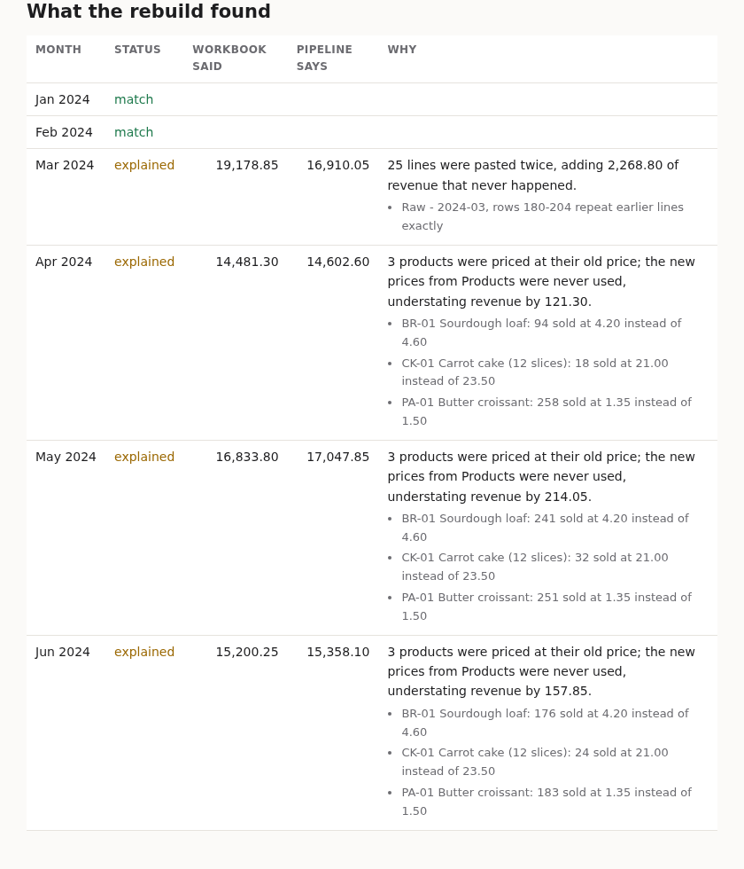

# SheetToPipeline

A small business's monthly Excel report rebuilt as a tested dbt pipeline, with a reconciliation
that proves the new numbers against the old workbook. DuckDB, dbt, openpyxl.

This file is the reference: what exists and how it works. `RUNBOOK.md` is the procedures,
`CLAUDE.md` the agent rules, `TASK.md` the open items.

## What it is

**Write-up and downloads: [m4dd0ck.github.io/sheet-to-pipeline](https://m4dd0ck.github.io/sheet-to-pipeline/)**
(the old workbook, the new report, and what changed)

"We run the business on this spreadsheet. Every month someone pastes the new export in and fixes
the summary by hand. Can you automate it?" This repo is that job end to end, for a fictional
wholesale bakery supplier:

| | Before | After |
|---|---|---|
| Input | order-system export pasted into a new tab | the same export, dropped in `data/incoming/` |
| Pricing | `VLOOKUP` into Products (first match wins) | price in force on the sale date |
| Totals | typed into the Summary tab | dbt mart, tested on every run |
| Output | the Summary tab | the same Summary layout, written to Excel, plus a Checks sheet |
| Effort | a monthly checklist | `s2p all` |

The business and its data are synthetic; the workbook is generated so the whole story can be
reproduced from a clean clone.

## Why it exists

Switching a business off its spreadsheet is only safe if the new numbers can be trusted, and
"trust me" is not an argument. The pipeline's summary is compared with every cell the old
workbook reported, and every difference has to be explained exactly or it is reported as
unexplained. The repo shows that job done once, end to end, on a story small enough to read.

## Quick start

Needs Python 3.12+ and [uv](https://github.com/astral-sh/uv).

```bash
uv sync
uv run s2p all            # build the old workbook, extract, dbt build, reconcile, report
```

One step at a time:

```bash
uv run s2p legacy         # legacy/Monthly Sales Report.xlsx - the "before"
uv run s2p extract        # raw tabs + data/incoming/*.csv -> DuckDB
uv run s2p run            # dbt build: models and tests
uv run s2p reconcile      # workbook vs pipeline, with causes
uv run s2p report         # output/Monthly Sales Report.xlsx in the old layout
```

Next month is a file, not a code change:

```bash
uv run s2p new-month 2024-07   # a sample export lands in data/incoming/2024-07.csv
uv run s2p extract && uv run s2p run && uv run s2p reconcile
```

July shows up as `new` in the reconciliation (the old workbook never had it). A month present in
both the workbook and a CSV is refused rather than counted twice.

## Commands

All run as `uv run s2p <command>`. The table is regenerated from `s2p --help` by the doc check;
edit the help strings in `src/sheet_to_pipeline/cli.py`, not this table.

<!-- generated:commands start -->
<!-- do not hand-edit: regenerated by doc-check --fix -->
| Command | What it does |
|---|---|
| `s2p legacy` | Write the original workbook (the "before"). |
| `s2p new-month` | Drop a sample export for a new month into data/incoming, as the order system would. |
| `s2p extract` | Load the workbook's raw tabs and any monthly CSVs into DuckDB. |
| `s2p run` | Build and test the dbt models. |
| `s2p reconcile` | Compare the workbook's Summary with the pipeline and explain each difference. |
| `s2p report` | Write this month's report in the familiar Summary layout. |
| `s2p site` | Build the before-and-after page with downloads. |
| `s2p all` | legacy, extract, run, reconcile and report, in order. |
<!-- generated:commands end -->

Defaults: the workbook is written to and read from `legacy/`, exports land in `data/incoming/`,
the DuckDB file and the report go to `output/`, the site to `site/`; all four are gitignored.
`site --out` and `legacy --path` override the location.

## How it works

### What the rebuild found

January and February match to the cent. The other months differ, and every difference is
explained exactly:



- **March was overstated by 2,268.80**: 25 lines of the export were pasted twice (rows 180-204).
- **April to June were understated by 493.20 in total**: three prices changed on 1 April and the
  new rows were added below the old ones in Products, so `VLOOKUP` kept returning the old price.

The split is exact, not estimated: the workbook's total is every pasted line at VLOOKUP's price
and the pipeline's is every real line at the correct price, so the gap decomposes line by line
into repeated lines and price differences. Anything that doesn't decompose is reported as
**unexplained** rather than hidden.

### Models

| Model | What it does |
|-------|--------------|
| `stg_sales_lines` | every pasted line with its tab and row; exact repeats within a month flagged, not dropped |
| `stg_products` | price list with `effective_from` / `effective_to` windows |
| `stg_reps` | reps and regions |
| `fct_sales_lines` | real lines only, priced on the sale date (range join) |
| `mart_monthly_summary` | the Summary tab, column for column |

Tests fail the build if any line has no price in force, a pasted line is unaccounted for (pasted =
kept + flagged repeats, per month), the summary doesn't add up to its lines and regions, or an
invoice line appears twice.

## Layout

```
src/sheet_to_pipeline/
├── legacy.py      # the "before" workbook, formulas and hand-kept Summary included
├── extract.py     # workbook tabs and CSV drops -> DuckDB, with row provenance
├── pipeline.py    # runs dbt
├── reconcile.py   # compare and explain
├── report.py      # Summary layout back to Excel + Checks sheet
├── site.py        # the before/after page
├── templates/     # the site page (Jinja)
└── cli.py         # s2p
models/            # staging and marts
data_tests/        # line accounting, summary totals
macros/            # schema naming
tests/             # one file per module, plus a new month and messy exports
```

Not in git: `legacy/`, `data/`, `output/`, `site/`, dbt artifacts.

## Outside the repo

| Thing | Where | Notes |
|---|---|---|
| Write-up site | GitHub Pages for this repo | built by `ci.yml` on every push to `main` after a full monthly run; no secrets |

## Vocabulary

**Pasted line.** One row of an export as it sits in a workbook tab, with its tab and row kept
as provenance.

**Repeat.** A pasted line identical to another in the same month: flagged, counted, excluded
from the facts, never silently dropped.

**Unexplained.** The part of a month's difference that neither repeats nor price changes
account for; reported, never hidden.

## Decisions

- **2026-06-03** Every difference is decomposed exactly into repeats and price changes, with
  the remainder shown as unexplained, so the reconciliation can never look better than it is.
- **2026-06-09** Repeated lines are flagged, not dropped, so the per-month line accounting test
  can prove nothing went missing.
- **2026-06-12** A month present in both the workbook and a CSV is refused rather than counted
  twice; messy exports become clear errors.
- **2026-06-13** The site is built in CI from the synthetic data, so it needs no secrets.
- **2026-10-17** pydantic dropped: nothing used it.
- **2026-10-20** Four-file skeleton.

## History

- **2026-05-11** First commit: the legacy workbook generator.
- **2026-05-27** v0.1.0: extract into DuckDB.
- **2026-06-03** v0.2.0: dbt models and the reconciliation.
- **2026-06-09** v0.3.0: the Excel report and the five CLI commands.
- **2026-06-13** v0.4.0: new-month flow, site, CI with Pages.
- **2026-10-06** v1.0.0: feature set done.
- **2026-10-17** CI on the shared template with locked sync; unused dependency dropped.
- **2026-10-20** Four-file skeleton.

## Development

```bash
uv sync
uv run ruff check . && uv run ruff format --check .
uv run mypy src/
uv run pytest
```

The full list is `RUNBOOK.md` §Validate. Paths the docs name that never exist in a checkout
(the generated workbook, exports, outputs) are listed in `.doc-check-ignore`.

## Pointers

- `RUNBOOK.md`: on open, on close, the monthly run, release, deploy, restore.
- `CLAUDE.md`: rules for agents working here.
- `TASK.md`: what is open.
- `~/developer/hq/CONVENTIONS.md`: release and commit conventions across the owner's repos.

## License

MIT
